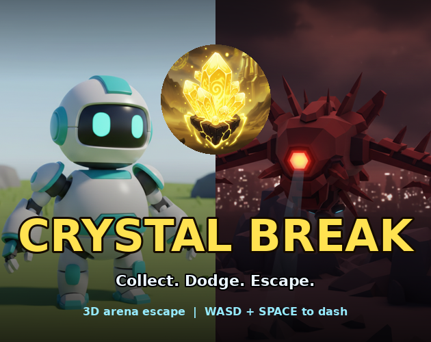

# CRYSTAL BREAK — Portfolio Game 3

> A top-down 3D arena escape game (Unity). Collect crystals, dodge drones and lava, reach the portal.

**▶ Play (download):** [FILL IN: GitHub Release link]  
**▶ Itch.io (bonus):** [FILL IN or delete]  
**🎬 Trailer:** [FILL IN: `Trailer/trailer.mp4` or link]  
**Engine:** Unity [FILL IN version, e.g. 2022.3 LTS] · **Platform:** Windows / Mac / WebGL

 <!-- replace with a real screenshot -->

## How to Play
| Input | Action |
|---|---|
| WASD / Arrows | Move |
| SPACE | Dash (short burst + brief invulnerability, 1s cooldown) |
| ENTER | Start |
| R | Restart after win/loss (no editor needed) |
| ESC | Quit |

**Goal:** collect all 8 crystals → the portal ring turns green → step into it.

## The Triad (Reward – Damage – End)
| Pillar | Implementation | Code |
|---|---|---|
| **Reward** | 8 crystals: +100 score each, SFX, HUD counter; clearing them opens the exit. Win bonus for health + speed. | `Collectible.cs`, `GameManager.AddCrystal` |
| **Damage** | 3 chasing drones (20 dmg), 5 lava zones (10 dmg), 0.6 s i-frames, screen flash + camera shake + SFX. Dash grants i-frames. | `Hazard.cs`, `EnemyChaser.cs`, `GameManager.Damage` |
| **End** | **Win:** all crystals + reach portal. **Loss:** HP 0. Title, Win, and Game-Over screens; in-game restart rebuilds the level. | `Portal.cs`, `GameManager.Win/Lose/Restart` |

## Audio (Week 6 pipeline)
Wired in `AudioManager.cs`: `collect` (reward), `damage` (hazard), `dash`, `win`, `lose`, `music` (loop).
Files live in `Assets/Resources/Audio/` and are loaded by name. Synthesized with `Tools/generate_audio.py` (Claude-written; see PROMPT_LOG §5).

## Tripo 3D Assets
| Asset | File in repo | Tris (Tripo → game) | Used as |
|---|---|---|---|
| Player robot | `Assets/Resources/Tripo/Player.glb` | 1.89 M → 40 k | the controllable character |
| Spiky drone | `Assets/Resources/Tripo/Enemy.glb` | 1.96 M → 30 k | chasing hazard (×3) |
| Glowing crystal | `Assets/Resources/Tripo/Crystal.glb` | 1.86 M → 15 k | collectible reward (×8) |
| Runic pillar | `Assets/Resources/Tripo/Pillar.glb` | 1.96 M → 20 k | solid environment prop (×10) |

Pipeline: Tripo `.glb` → `Tools/optimize_tripo_glb.py` (decimation / retopology + texture bake) → Unity via glTFast. Details, prompts and errors: [PROMPT_LOG.md](PROMPT_LOG.md) §2–3. Preview: `Docs/tripo_models_preview.png`.

`GameBootstrap.Visual()` auto-loads these by name, auto-scales to a target height, and seats them on the ground.

## Build / Run From Source
1. Install Unity [version] and create a **new 3D (Built-in or URP) project**.
2. Close Unity, copy this repo's `Assets/` folder (and `.gitignore`) into the project folder.
3. Open the project. Package Manager → **Add by name** `com.unity.cloud.gltfast` (needed for `.glb`).
4. *Edit → Project Settings → Player → Other Settings → Active Input Handling = **Both*** (scripts use the classic Input API).
5. Open any scene (even empty) and press **Play** — `GameBootstrap` builds the level at runtime.
6. Build: *File → Build Settings → add the open scene → Build* (Windows/Mac/WebGL).

## Repository Layout
```
Assets/Scripts/            C# gameplay (9 scripts)
Tools/                     optimize_tripo_glb.py, generate_audio.py, make_cover.py
Assets/Resources/Tripo/    Tripo-generated models (Player, Enemy, Crystal, Pillar)
Assets/Resources/Audio/    collect/damage/dash/win/lose/music
Trailer/                   trailer.mp4 + stills
Docs/                      PROMPT_LOG.md, ATTRIBUTION.md, REFERENCES.md, TRAILER_PLAN.md
```
(Master log: [PROMPT_LOG.md](PROMPT_LOG.md) · Attribution: [ATTRIBUTION.md](ATTRIBUTION.md) · References: [REFERENCES.md](REFERENCES.md))

## Generative AI Toolchain
| Domain | Tool | Used for |
|---|---|---|
| Code | Claude (Anthropic) [+ Codex / Cursor if used] | Scripts, architecture, README |
| 3D | Tripo (tripo3d.ai / MCP) | 4 game assets |
| Audio | [FILL IN: e.g. ElevenLabs SFX, Suno] | SFX + music |
| Image / Video | [FILL IN: e.g. Midjourney, Runway, Kling] | Key art, trailer shots |
| Editing | [FILL IN: CapCut / DaVinci] | Trailer assembly |

## Known Issues
- [FILL IN honestly, e.g. enemies pass through pillars (they're "hovering drones")]
